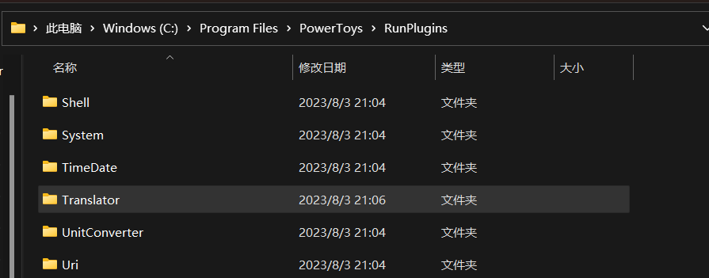

# 安装

1. 关闭 PowerToys
2. 下载 [Translator.zip](https://github.com/N0I0C0K/PowerTranslator/releases)
3. 解压后，将包含 `plugin.json`、`Translator.dll` 和 `Images` 的 **Translator 文件夹**复制到`%LOCALAPPDATA%\Microsoft\PowerToys\PowerToys Run\Plugins`。若解压软件自动创建了同名外层目录，请进入该目录后再复制，最终路径必须是 `Plugins\Translator\plugin.json`，不要多套一层文件夹。
   如图所示
   

4. 启动 PowerToys

## 如何升级

1. 关闭 PowerToys
2. 下载新版本`Translator.zip`.
3. 用解压后的 Translator 文件夹覆盖原先的 `Plugins\Translator`，确认 `plugin.json` 直接位于该文件夹内。
4. 启动 PowerToys

## Via [ptr](https://github.com/8LWXpg/ptr)

### 安装

```shell
ptr add Translator N0I0C0K/PowerTranslator
```

### 升级

```shell
ptr u Translator
```
