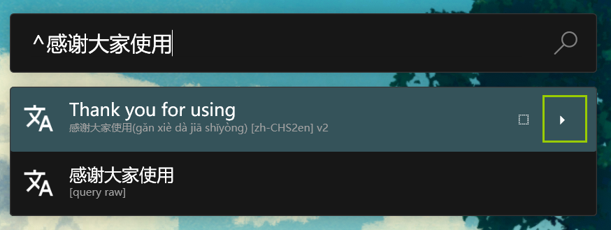
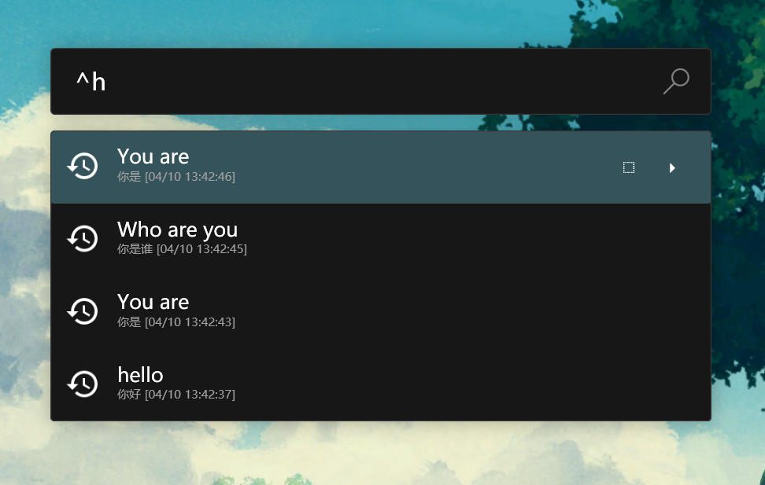
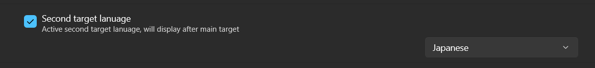
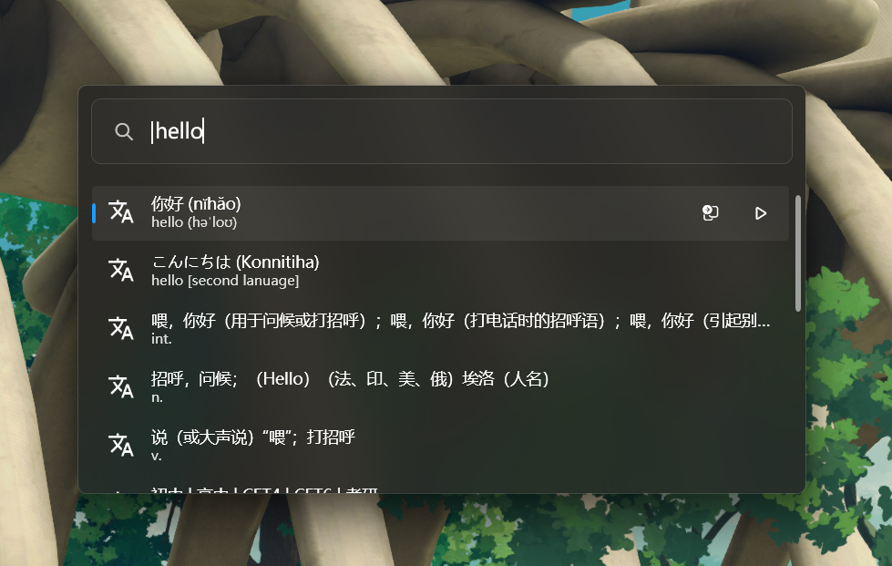
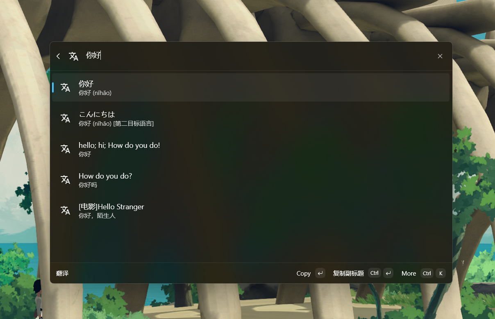
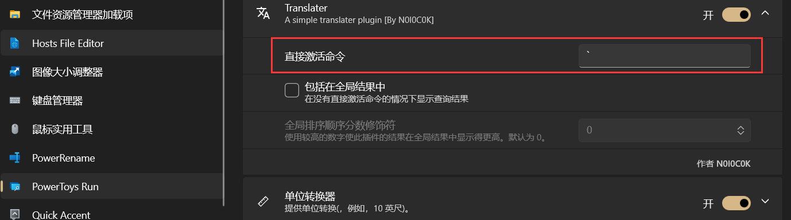
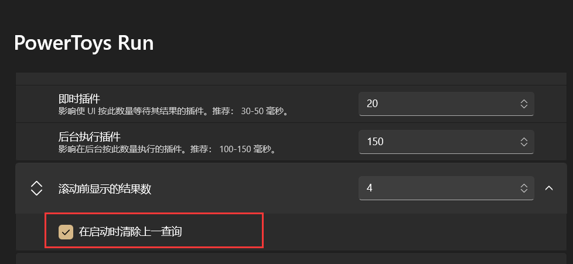
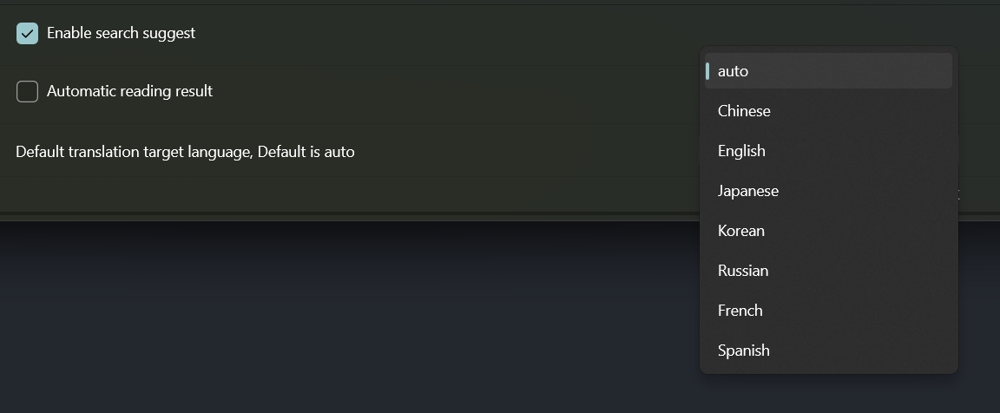

<div align="center">
<h1>PowerTranslator</h1>
<p>一个用于<a href=https://github.com/microsoft/PowerToys>PowerToys Run</a>的翻译插件, 快速, 稳定.</p>
<p>支持 cmdpal</p>

    [](https://github.com/hlaueriksson/awesome-powertoys-run-plugins)

[English](./readme_en.md)

</div>

## About

一个用于[PowerToysRun](https://github.com/microsoft/PowerToys)的插件。现已接入多个平台提供**快速且稳定**的翻译

## Index

- [如何使用](#usage)
  - [cmdpal](#支持-cmdpal)
- [开发命令](#开发命令)
- [安装](#install)
- [设置](#setting)
- [提交问题](#issue)
- [贡献](#Contribution)

## 开发命令

项目根目录的 [justfile](./justfile) 统一了开发、测试和打包命令。执行 `just` 或 `just help` 可查看完整列表。

```powershell
# 传统 PowerToys Run 插件
just legacy-build-all
just legacy-pack-all

# Command Palette 扩展
just test
just cmdpal-build-all
just cmdpal-install-local
just cmdpal-clean-local
just cmdpal-store
```

`cmdpal-install-local` 会构建、自签名并安装实际的本地 `.msix`，适合 e2e 验证；其临时证书位于被 Git 忽略的 `cmdpal/.local-cert/`，密码使用当前用户的 DPAPI 加密。为满足 Windows 的 MSIX 安装规则，首次运行会经 UAC 确认把公钥导入 `LocalMachine\TrustedPeople`。若检测到旧扩展正在运行，会先展示 PID 并等待确认后才停止它。`cmdpal-clean-local` 也会经 UAC 删除该信任及证书目录；不会卸载应用。

`cmdpal-store` 会构建 x64 和 ARM64 的 Microsoft Store `.msixbundle` 到 `dist/`；构建前仍会执行现有脚本中的应用清单检查。

## 翻译引擎巡检

[Translation engine health](../../actions/workflows/engine_health.yml) 每两天在北京时间 09:23 检查一次，也可在 Actions 页面通过 **Run workflow** 手动运行。工作流每天触发后按 UTC 日期奇偶判断是否执行检查，因此跨月也保持两天间隔；GitHub 调度可能延迟。合并到默认分支后定时生效。

巡检直接调用 PowerToys Run 和 Command Palette 两套实现中的所有引擎（目前各有有道 V2、有道旧版、有道备用、DeepL 和阿里翻译），不经过自动回退。每个引擎独立完成初始化、将“苹果”翻译为英文并验证译文，最多尝试三次，每次限时 60 秒。任一引擎失败都会使 CI 失败；Actions 摘要和保留 30 天的 TRX 附件会记录各引擎结果。它反映 GitHub runner 所在网络的可用性，地域限制或服务限流也可能导致失败。

请在 GitHub 的 **Settings → Notifications → Actions** 开启失败通知；按 [GitHub 通知规则](https://docs.github.com/en/actions/concepts/workflows-and-actions/notifications-for-workflow-runs)，通知通常发送给创建工作流或最后修改 cron 的用户，重新启用工作流后则发送给重新启用者。公开仓库连续 60 天没有活动时，GitHub 会自动停用定时工作流，需在 Actions 中重新启用。

普通 PR 和 `just test` 只运行离线测试。需要在本地巡检时，先设置 `$env:RUN_ENGINE_HEALTH_CHECKS = '1'`，再运行 `just test Release 'TestCategory=EngineHealth'`；结束后用 `Remove-Item Env:RUN_ENGINE_HEALTH_CHECKS` 清除该变量。新增实现 `ITranslator` 的具体类会自动加入巡检。

## Usage

- 默认触发键为`|`.（下方GIF演示采用的自定义触发键`^`）
- 指定翻译文本

  - `alt+space`打开 PowerToysRun, 输入`^[你要翻译的地方]`
  - `Enter`复制翻译结果到剪贴板

  演示翻译 `command`
  

  演示翻译 `命令`
  

- 中文带有拼音
  参考上方演示翻译`命令`

- 快速翻译剪贴板

  - 当剪贴板内有文字, 直接键入触发关键字`^`, 即可快速翻译剪贴板内的内容

    

- 指定翻译目标语言

  - 使用 `^[words]->[Target language]`, 例如: `^你好->ja` 表示把你好翻译为日文
    
    常用语言代码
    |语言|代码|备注|
    |---------|------|-|
    |汉语(简体) | zhs | 汉语简体
    |汉语(繁体) | zht| 漢語翻譯
    |日语 |ja| 日本語
    |英语 |en| English
    |韩语 |ko| 한국어
    |法语 |fr| En français
    |俄语 |ru| русский

- 搜索建议

  - 根据当前的输入建议搜索内容
    
  - 可以在设置里选择是否启用建议, 对应`Enable search suggest`

- 朗读内容

  - 支持朗读中文, 英文(快捷键 ctrl+enter)
    
  - 基于有道 TTS 接口
  - 支持自动朗读结果功能, **默认关闭**, 可以在设置开启.对应`Automatic reading result`

- 历史记录
  - 键入`h`或者剪贴板内无翻译目标会显示历史翻译记录.
    
  - 默认 **15** 条记录
  - **为什么不支持自定义上限条目?**
    因为官方只开放了 bool 类型的自定义参数, 所以目前不支持自定义历史记录上限. 等待后续支持我会更新.或者可以下载源码自行修改编译.

- 第二语言
  - 开启第二翻译目标语言，默认关闭
  
  - 开启后会在每次翻译的时候自动展示第二语言结果
  


### 支持 Cmdpal
所有 Powertoys Run 的功能同样也支持在 cmdpal 中使用



## Install

### Cmdpal

通过 MicroStore 安装 - [商店页面](https://apps.microsoft.com/store/detail/9NWN01SZ6KNK?cid=DevShareMCLPCS)

### PowerToys Run 插件

1. 关闭 PowerToys
2. 下载 [Translator.zip](https://github.com/N0I0C0K/PowerTranslator/releases)
3. 解压到`%LOCALAPPDATA%\Microsoft\PowerToys\PowerToys Run\Plugins`
   如图所示
   
4. 启动 PowerToys

(参考官方[第三方插件安装文档](https://github.com/microsoft/PowerToys/blob/main/doc/thirdPartyRunPlugins.md))

---

Via [ptr](https://github.com/8LWXpg/ptr)

```shell
ptr add Translator N0I0C0K/PowerTranslator
```

[安装-升级 详细教程](./doc/how%20to%20install.md)

## Setting

- 如果触发按键冲突, 修改默认触发键 (建议修改为" \` ", 同时建议检查一下有无冲突)。**注意在v0.8之后默认触发按键是`"|"`，无需再次修改**
  
- 建议勾选`输入平滑`, 可以优化输入体验
  
- `启动时清除上一查询`可以快速触发翻译剪切板, **按需求勾选.**
  
- 切换默认目标翻译语言，默认是`auto`
  

## Issue

如果发现了无法翻译, 出现了未知错误, 需要新的功能, 欢迎提交 issue. 我会及时修复或改进

## Contribution

### Environment

- .net sdk 8.0

### Step

1. fork 这个仓库
2. clone fork 后的仓库到本地
3. 运行 `dotnet restore`(可选)
3. 使用 vscode（任意） 打开
5. 开始编码吧！

[帮助文档 - Getting Start!](doc/code-start-zh.md)
